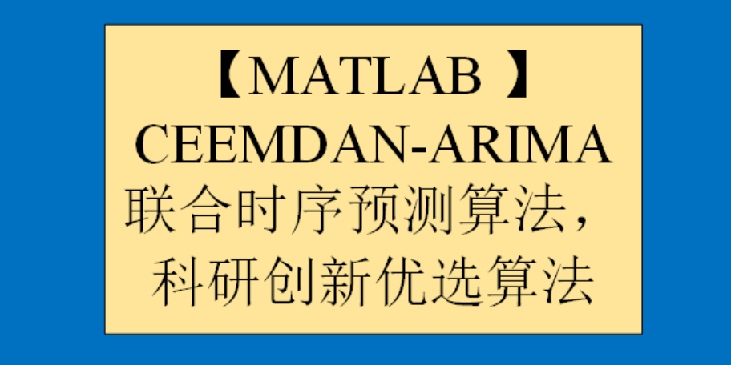

# [MATLAB] CEEMDAN-ARIMA Joint Time Series Forecasting Algorithm, Preferred Research and Innovation Algorithm

Intention to obtain the code, please refer to the end of this message for the method of obtaining the code~ 
1 CEEMDAN Signal Decomposition Algorithm CEEMDAN decomposition is also known as Adaptive Noise-Compliant Complete Ensemble Empirical Mode Decomposition, English full name is Complete Ensemble Empirical Mode Decomposition with Adaptive Noise.  
CEEMDAN is an improvement on CEEMD, it introduces an adaptive noise auxiliary method that can better handle high-frequency noise in signals. The main steps of CEEMDAN are as follows:  
Randomly perturb the original signal several times to obtain multiple noise perturbation datasets.  
Perform CEEMD decomposition on each noise perturbation dataset to obtain multiple CEEMD decomposition sets.  
For each CEEMD decomposition set, introduce an adaptive noise auxiliary method by adding noise signals to each local mode function to enhance the signal's edge and high-frequency parts.  
Average the corresponding components of each adaptive noise auxiliated CEEMD decomposition set to obtain the final CEEMDAN decomposition result. CEEMDAN decomposition has better adaptability to high-frequency noise and can more accurately decompose signals. Therefore, CEEMDAN has been widely used in signal processing, image processing, and pattern recognition fields.  
To use EMD decomposition in MATLAB, you first need to install the EMD decomposition MATLAB toolkit.  
EMD toolkit installation: In MATLAB, open the package_emd folder, run install_emd. M and index_emd. M as shown in the figure below to complete the toolkit installation.  
MATLAB Signal Decomposition Fourth Period - CEEMDAN:  
Details about signal decomposition family can be seen in:
2 ARIMA Time Series Forecasting Algorithm
The Autoregressive Integrated Moving Average (ARIMA) model is a predictive model based on time series analysis, suitable for analyzing and forecasting data with both temporal dependence and randomness. The ARIMA model was first proposed by Box and Jenkins in 1976 and has become a widely used time series model for data prediction in production and finance sectors. The core idea of the ARIMA model is to differentiate the time series data to make it stationary, then establish the model through the combination of autoregression (AR) and moving average (MA), and use this model for forecasting. In the ARIMA model, "AR" stands for autoregression, indicating that current data are related to the data from several previous moments; "I" stands for differencing, which means to differentiate the data to make it stationary; "MA" stands for moving average, indicating that current data are related to the errors from several previous moments. The establishment process of the ARIMA model includes three steps: model identification, parameter estimation, and model verification. In the model identification stage, the order of the ARIMA model and the number of differencing times need to be determined; in the parameter estimation stage, the model needs to be estimated; in the model verification stage, the model needs to be verified and judged whether the prediction accuracy meets the requirements. The advantages of the ARIMA model include fully utilizing the historical information of time series data for prediction, adaptability to various types of time series data, and good explanatory power. However, there are also some disadvantages to the ARIMA model, such as the need to differentiate non-stationary time series data, and the process of parameter estimation is relatively complex.
3 CEEMDAN-ARIMA Joint Time Series Prediction Algorithm
The following will detail the principle and thought process of the latest CEEMDAN-ARIMA joint time series prediction algorithm.
Signal decomposition can divide the raw data into N layers of imf components, then this study expands ARIMA time series prediction for each layer's imf component, and reconstructs the predicted values of the imf components to obtain the CEEMDAN-ARIMA joint time series prediction value.
By comparing the CEEMDAN-ARIMA joint time series prediction value with the pure ARIMA time series prediction value against the true values, we can find that the CEEMDAN-ARIMA joint time series prediction algorithm has a good predictive effect. The reason is not difficult to see; signal decomposition divides the raw data into different frequency data, which means that the frequency of each layer's imf component is roughly the same, indicating data with good periodicity and regularity. Therefore, when using the ARIMA time series prediction algorithm to predict each layer's imf component, its prediction effect will be closer to the true value.
Below is a brief video tutorial.
\n\n\n\n\n\nTo view this video please enable JavaScript, and consider upgrading to a web browser that supports HTML5 video

## Images

<!-- PAYMENT_BLOCK -->

## Get this dataset

- Payment link (Stripe): [Buy now](https://buy.stripe.com/3cs8yP7sY87d0vu9AB)
- Payment QR code: 

<!-- /PAYMENT_BLOCK -->
